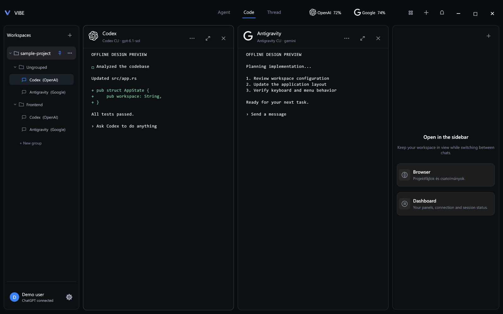
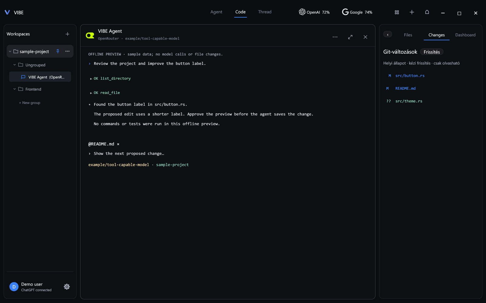
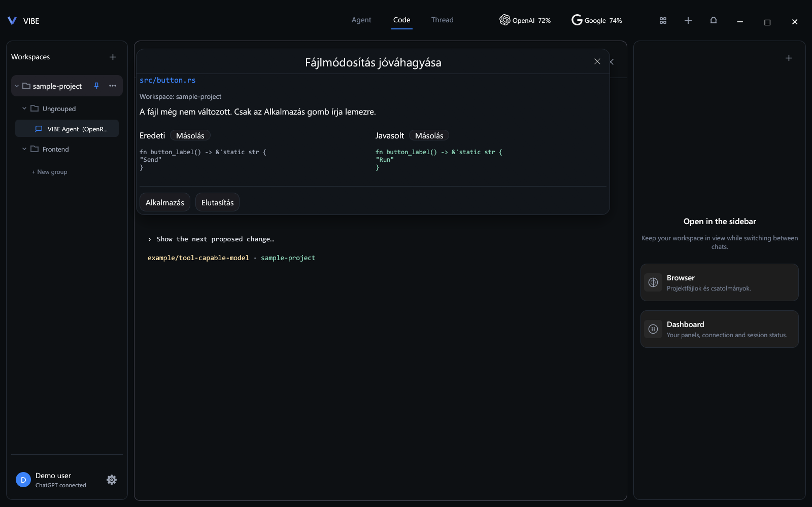

# VIBE

An open-source Rust desktop workspace for running multiple AI coding agents side by side. Use native Codex and Antigravity CLI sessions, or work with the built-in OpenRouter coding agent in the same project workspace.

**[Download for Windows](https://github.com/Szilaay/Vibe/releases/latest)** · **[MIT license](LICENSE)** · **[Detailed Hungarian documentation](README.hu.md)**



*Real application UI rendered offline with synthetic sessions and sample account data. Some interface labels are currently Hungarian.*

## What you can do

- **Run multiple agents together.** Keep independent sessions, models and drafts in resizable panels with focus, column and grid layouts.
- **Organize projects.** Pin workspaces, group conversations, rename panels and add a description to each chat.
- **Bring your own access.** Sign in through the native Codex or Antigravity flow, or enter your own OpenRouter API key and model ID.
- **Work with project files.** Browse files, inspect local Git changes and attach file snapshots to OpenRouter prompts.
- **Review edits before saving.** The built-in OpenRouter agent proposes file changes for your approval and checks for conflicting changes before writing.
- **Set workspace rules.** Define global VIBE instructions, override them per workspace, disable global inheritance or reference a local rules file.
- **Continue previous work.** Save conversations, drafts and native terminal snapshots, then resume supported native CLI sessions.
- **Dictate locally on Windows.** Optional Hungarian dictation uses whisper.cpp and a local model.
- **Receive signed updates.** The Windows installer preserves application data; updates are verified before installation.

## Agents and access

| Agent | Integration | Access |
| --- | --- | --- |
| Codex | Original CLI in a native PTY terminal | The CLI's own sign-in and account permissions |
| Antigravity | Original CLI in a native PTY terminal | The CLI's own Google sign-in and account permissions |
| OpenRouter | Built-in VIBE coding agent with a terminal-style interface | Your OpenRouter API key and selected model |

Each provider controls its own model availability, account limits and billing. OpenRouter requests use your API credits. The built-in agent can make multiple model calls during one task.

The OpenRouter agent currently supports `list_directory`, `read_file`, `search_files` and `write_file`. It has no shell execution, test runner or file-deletion tool. Native CLI capabilities and permission prompts are handled by the corresponding CLI.

## Project files and Git changes

The right sidebar provides a lazy-loaded file browser, text previews and a local Git changes view. Attach files to the selected OpenRouter prompt; VIBE reads the permitted file contents when you send the message.



## Edit review

Inspect the original and proposed text before approving an OpenRouter file write. Rejecting or closing the review leaves the file untouched. If the original file changes before approval, the agent reports a conflict instead of silently overwriting it.



## Install on Windows

1. Open the [latest release](https://github.com/Szilaay/Vibe/releases/latest).
2. Download and run `VIBE-Setup-x.y.z.exe`.
3. Choose a CLI, select your project folder and connect the relevant account or API key.

The installer targets **Windows 10/11 x64**, installs for the current user and includes the offline dictation components and required runtime libraries. A fresh installation starts with an empty workspace list; it does not create sample projects or open the launch directory as a workspace.

Installed versions can check for updates from the account/settings menu. VIBE verifies an Ed25519 signature, the download size and SHA-256 checksum before offering installation. This update signature is separate from Windows Authenticode signing; the current installer does not have an Authenticode publisher certificate.

Account settings, saved conversations and terminal snapshots are stored separately from the installation directory and are preserved during updates and uninstalling.

## Build from source

Requirements:

- Rust stable, with Rust 1.88 or later as the package minimum.
- **Windows:** Visual Studio C++ Build Tools and the Windows SDK resource compiler.
- **Linux:** system libraries for the desktop UI and audio. The dependencies used in CI are listed below.
- **macOS:** the standard Rust and Xcode command-line build toolchain.

```sh
git clone https://github.com/Szilaay/Vibe.git
cd Vibe
cargo build --locked --bin vibe
cargo run --locked --bin vibe
```

Linux dependencies used by the [CI workflow](.github/workflows/ci.yml):

```sh
sudo apt-get update
sudo apt-get install -y libxkbcommon-dev libwayland-dev libx11-dev libxi-dev libgl1-mesa-dev libasound2-dev pkg-config
```

The regular desktop build does not require the speech model. Windows is the packaged distribution; Linux and macOS use source builds.

### Optional Windows dictation assets

Run in PowerShell to download the pinned speech engine and model, with checksum verification:

```powershell
./scripts/package-speech.ps1
```

Keep the generated `speech` directory beside the executable. To build a portable package with these assets:

```powershell
./scripts/package.ps1 -UseExistingSpeech
```

### Development checks

```sh
cargo fmt --all --check
cargo clippy --locked --all-targets -- -D warnings
cargo test --locked --all-targets
```

The vendored `egui-winit` patch is required for image-only clipboard paste into native CLI sessions. Its purpose is documented in [VIBE-PATCH.md](vendor/egui-winit/VIBE-PATCH.md).

## OpenRouter setup

Create an OpenRouter panel, enter your API key and choose a model ID, such as `openrouter/auto`. You can also set the `OPENROUTER_API_KEY` environment variable before launching VIBE.

Keys entered in the app are session-only and are not written to conversation files. No API key or signed-in account is bundled with the source or installer.

Built-in commands:

- `/help` — show available commands and tools.
- `/model` — inspect the model; `/model provider/model` changes it.
- `/clear` — clear the conversation in the selected agent panel.

## Native CLI input

| Shortcut | Behavior |
| --- | --- |
| `Enter` | Submit input |
| `Shift+Enter` | Insert a new line |
| `Ctrl+A` | Select input in a recognized editable prompt; native menus retain their own shortcut |
| `Backspace` / `Delete` | Delete the selected input range |
| `Ctrl+Z` | Undo up to 10 captured input states in supported visible prompts |
| `Shift` + drag, then `Ctrl+C` | Copy previous terminal output without modifying it |

Normal dragging is limited to the editable prompt. Empty terminal space and the Codex session picker do not receive VIBE's text selection overlay. Native undo is limited to text the terminal can reconstruct; collapsed pasted content, image attachments and hidden input are not reconstructed from display labels.

## Privacy and permissions

Conversations and terminal snapshots are stored locally. The selected AI provider receives the prompts and context sent to it. The OpenRouter agent reads project files through workspace-scoped tools; common secret files, generated directories and paths outside the workspace are restricted. These filters are not a guarantee that every sensitive file will be detected.

Native CLIs own their authentication, networking, tools and permission handling. VIBE's workspace-rule inheritance toggle controls VIBE instructions; it does not remove a CLI's independent profile, organization or project rules.

The repository excludes local account files, API keys, private update-signing keys, generated binaries, saved sessions and large speech assets. The public update verification key is intentionally included.

## Releases and contributions

Source changes use normal Git commits. Binary releases are published separately through the [release scripts](scripts/). Forks need their own release repository and signing keys to distribute their own signed updates. The publisher does not overwrite the repository README.

Bug reports and focused pull requests are welcome. Include the platform, VIBE version and steps to reproduce; redact credentials and private conversation contents.

## License

VIBE's own source code is available under the [MIT license](LICENSE). Vendored code and provider assets retain their respective licenses and notices in [vendor](vendor/) and [assets/providers](assets/providers/).
